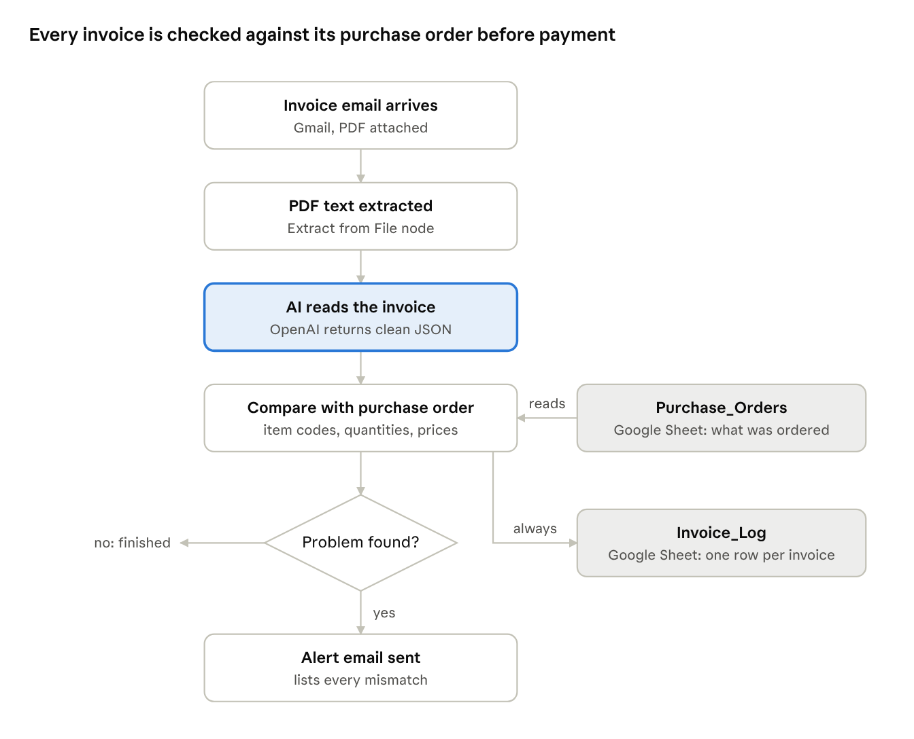

# AI Invoice Checker

An n8n workflow that reads supplier invoices with AI and checks them against purchase orders, so wrong prices and quantities are caught before anyone pays.



<!-- Add your demo video link here, for example: **Demo video:** https://www.loom.com/... -->

## The problem

Procurement and accounts-payable teams compare supplier invoices with purchase orders by hand. It takes time, and mistakes slip through: a unit price higher than agreed, or more items billed than were ordered.

## What the workflow does

1. A supplier invoice arrives by email as a PDF.
2. The PDF text is extracted, and an AI model (OpenAI API) turns it into structured data: supplier, PO number, line items and totals. It works for English and German invoices with different layouts.
3. The workflow finds the matching purchase order in Google Sheets and checks every line: item code, quantity, unit price, net total, supplier name and the VAT maths.
4. Every result is written to an `Invoice_Log` sheet. Any problem sends an alert email.

## Results on the sample data

The 5 sample invoices come from fictional suppliers. Two contain deliberate errors.

| Invoice | Supplier | Language | Result | What was found |
| --- | --- | --- | --- | --- |
| INV-24817 | Lindhof Industriebedarf GmbH | English | OK | All items match |
| DV-2026-1193 | Donautal Verpackung & Logistik GmbH | English | MISMATCH | Stretch film billed at 14.40 instead of 12.90 (EUR 45.00 too much) |
| VE-50342 | Vilstal Elektrokomponenten GmbH | English | OK | All items match |
| NW/2026/0788 | Naabwerk Stahlhandel GmbH | English | MISMATCH | 25 steel pipes billed, 20 ordered (EUR 137.50 too much) |
| RE-2026-0457 | Haidenaab Bürobedarf GmbH | German | OK | All items match (German number and date format) |

## Tech stack

- **n8n** – workflow automation (10 nodes)
- **OpenAI API** – called directly with an HTTP Request node; returns JSON
- **Google Sheets** – purchase orders and the results log
- **Gmail** – invoice intake and alert emails
- **JavaScript** – n8n Code nodes for the prompt, parsing and comparison logic
- **Python** – generates the sample invoices (reportlab) and spreadsheet (openpyxl)

## Design decisions

- **AI reads, rules check.** The AI handles messy layouts and two languages. Fixed rules do the checking, so every result is exact and easy to audit.
- **Safe by default.** If the AI answer is not valid JSON, or the PO cannot be found, the invoice gets status `ERROR` or `NO PO` and an alert. Nothing is approved automatically.
- **Matching by item code**, with the description as a fallback. Amounts are compared with a 1-cent tolerance.
- **Fictional data only.** Real invoices would need GDPR-compliant processing and an agreement with the AI provider.

## Project structure

```
ai-invoice-checker/
├── workflow/
│   ├── invoice_checker_workflow.json   # import this into n8n
│   └── code/                           # the JavaScript inside the Code nodes
├── sample-data/
│   ├── invoices/                       # 5 sample invoice PDFs
│   └── Purchase_Orders_and_Invoice_Log.xlsx
├── tests/
│   ├── test_logic.js                   # tests the logic without n8n
│   └── fixtures/
├── tools/                              # Python scripts that generate the data and workflow
└── docs/workflow-diagram.png
```

## Run it yourself

1. Upload `sample-data/Purchase_Orders_and_Invoice_Log.xlsx` to Google Drive and use **File → Save as Google Sheets**.
2. In n8n, create a workflow and use **Import from File** with `workflow/invoice_checker_workflow.json`.
3. Connect your Gmail, Google Sheets and OpenAI credentials. Pick your sheet in both Google Sheets nodes and put your email address in **Send Alert Email**.
4. Email yourself one invoice from `sample-data/invoices/` with "Invoice" or "Rechnung" in the subject, then run the workflow.

**Test the logic without n8n** (needs Node.js):

```bash
node tests/test_logic.js
```

**Regenerate the sample data and workflow** (needs Python 3):

```bash
pip install -r requirements.txt
python tools/make_invoices.py sample-data/invoices
python tools/make_sheet.py sample-data/Purchase_Orders_and_Invoice_Log.xlsx
python tools/make_workflow.py workflow/invoice_checker_workflow.json
python tools/make_test_fixtures.py
```

## Next steps

- Three-way match: also check goods received, not only the order
- Approve and Reject buttons in the alert email
- A KPI dashboard: share of invoices OK, money caught per month
- The same workflow in Microsoft Power Automate

## About

Built by Raiyan Aamir, Digital Technology and Management student at OTH Amberg-Weiden, as a portfolio project that applies the Business Processes Management and Logistics modules. Built with help from an AI assistant. All companies, people and numbers in the sample data are fictional.
